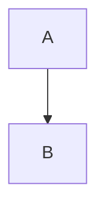
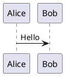

Fixture searchable unique content.

## First section

First paragraph.

```js
console.log("hello");
```

```js [named.js] {1}
console.log("named");
```

```js [one.js] tab
console.log("one");
```

```js [two.js] tab
console.log("two");
```

## Second section

Second paragraph.

A footnote reference.[^note]

[^note]: Footnote explanation.

<script>alert('attacker')</script>


[Offline link](https://example.invalid/test)

[Hash target](/@writer/post02#github-1)

[Privacy page](/privacy)

[Feed file](/feed.xml)

https://x.com/example/status/123456789

<details>
<summary>Closed X URL</summary>

https://x.com/example/status/111

https://www.youtube.com/watch?v=abc_123

</details>

<details open>
<summary>Open X URL</summary>

https://x.com/example/status/222

</details>

<details>
<summary>Outer X details</summary>

<details open>
<summary>Inner initially open X code</summary>

<blockquote class="twitter-tweet"><p>hello</p>&mdash; Name (@user) <a href="https://twitter.com/user/status/333">date</a></blockquote><script async src="https://platform.twitter.com/widgets.js"></script>

</details>

<details>
<summary>Inner closed X URL</summary>

https://x.com/example/status/444

</details>

</details>





https://github.com/writer/project/blob/main/example.ts

```ts [fake.ts] githubEmbed=true
const fake = true;
```

<blockquote class="twitter-tweet"><p>First line

https://t.co/example</p>&mdash; Name (@user) <a href="https://x.com/user/status/555">date</a></blockquote>
<script async src="https://platform.x.com/widgets.js"></script>

## Markdown preview

```md
# Unnamed preview
```

```md [article.md]
# Article preview

**Article bold**

> [!NOTE]
> Alert NOTE

> [!TIP]
> Alert TIP

> [!IMPORTANT]
> Alert IMPORTANT

> [!WARNING]
> Alert WARNING

> [!CAUTION]
> Alert CAUTION

> [!UNKNOWN]
> Alert UNKNOWN

 
```

```markdown [a-very-long-markdown-filename-for-mobile-layout-testing.md]
# Mobile preview
```

```markdown [group.md] tab
# Group preview
```

```text [group.txt] tab
plain group
```

<script src="https://gist.github.com/writer/abcdef.js"></script>


IDN fixture: [example](https://例え.テスト/path)

```text
visible‮hidden
```

## Icon :icon{name="rocket" size="2xl" label="Rocket"}heading

Icon xs: :icon{name="square-letter-a" size="xs"}

Icon sm: :icon{name="square-letter-a" size="sm"}

Icon base: :icon{name="square-letter-a" size="base"}

Icon lg: :icon{name="square-letter-a" size="lg"}

Icon xl: :icon{name="square-letter-a" size="xl"}

Icon 2xl: :icon{name="square-letter-a" size="2xl"}

Icon fixture :icon{name="rocket"} and :icon{name="circle-check" label="Lucideonlytoken"}.

```text [a-very-long-filename-for-testing-visible-connection-warning-guard.txt] href=https://gоogle.test
filename guard text
```

```md [a-very-long-filename-for-testing-visible-connection-warning-guard.md] href=https://gоogle.test
filename guard markdown
```

```md [a-very-long-filename-for-testing-visible-connection-warning-linked.md] tab href=https://gоogle.test
filename guard group
```

```text [guard-linked.txt] tab
other group text
```

```text [a-very-long-filename-for-testing-visible-connection-warning-group.txt] tab href=https://gоogle.test
filename guard plain tab
```

```text [another.txt] tab
another group
```

Math layout: $x = \frac{-b \pm \sqrt{b^2 - 4ac}}{2a} + \sum_{i=1}^n x_i$

````md [math-preview.md]
Math layout: $x = \frac{-b \pm \sqrt{b^2 - 4ac}}{2a} + \sum_{i=1}^n x_i$

```python
from x import y

print(y)
```
````

<details>
<summary>Hash outer</summary>

<details>
<summary>Hash inner</summary>

##### Hash target

Hash target body.

<div style="height: 2000px"></div>

</details>

</details>
